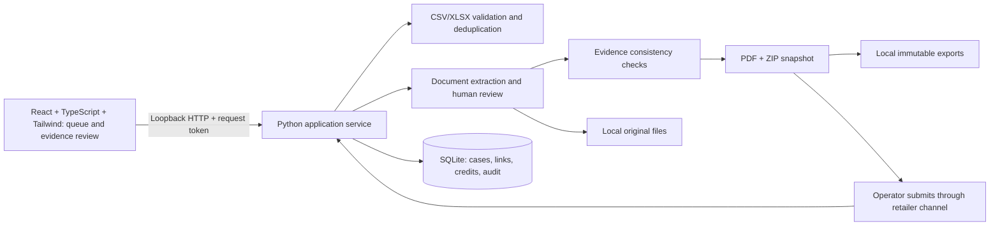

# ClaimLedger — local MVP

A single-operator workbench for investigating grocery shortage deductions, preparing reviewable evidence packets and tracking actual credits. All demonstration records are fictional. This is a functional local pilot, not a retailer-certified dispute integration.

The current frontend uses **React 19, strict TypeScript, Tailwind CSS 4, Vite 7 and Lucide icons**, with ClaimLedger's green-and-lime design. The backend uses Python and SQLite. The compiled frontend is included, so normal use requires only the Python server; no separate Node process is needed.

## Project files

- `frontend/src/`: current React components, typed API client and Tailwind styles.
- `frontend/dist/`: compiled frontend served by the local application.
- `frontend/README.md`: frontend setup, development and component guide.
- `app/` and `server.py`: Python API, evidence checks, OCR, packet generation and persistence.
- `data/`: SQLite database, original documents and exported packets.
- `tests/` and `frontend/tests/`: backend and frontend request tests.
- `VALIDATION.md`: completed automated and browser checks.
- `static/`: former vanilla frontend, retained as a reference and no longer served.

## Start on this computer

Double-click `Start-ClaimLedger.cmd`, or open PowerShell in this folder and run:

```powershell
.\Start-ClaimLedger.ps1
```

Open **http://127.0.0.1:8765**. Keep the terminal open. Stop with Ctrl+C. If the app is already running, open the URL; do not start a second copy on the same port. An alternate port can be chosen with `-Port 8766`.

The launcher uses an existing virtual environment, the bundled Python runtime on this computer, or a system Python. On another computer, install Python 3.11+ and dependencies:

```powershell
python -m venv .venv
.\.venv\Scripts\python.exe -m pip install -r requirements.txt
.\Start-ClaimLedger.ps1
```

## Walk through the product

1. Start in **Demo**. NF-1043 has consistent evidence; NF-1042 has a pallet-only receipt; NF-1044 has a quantity mismatch; NF-1045 has £120 approved and only £60 credited. NF-1046 has missing evidence and no confirmed deadline.
2. Open NF-1043. Review each original and its confirmed fields. Export a reviewed PDF or ZIP containing unchanged originals and a SHA-256 manifest.
3. Record submission only after submitting through the retailer's own channel. Record the retailer decision, then actual credits. Partial approvals and partial credits are separate values.
4. Try `fixtures/demo-import.csv` in **Demo**. Map columns, validate, and confirm. Repeating the import skips the duplicate. Upload `fixtures/demo-invoice.txt` to the imported case and review its fields.
5. Switch to **Live** for your own cases. The live workspace starts empty. Demo and Live records cannot be linked together.

## Implemented

- Persistent SQLite records, private local file storage, distinct Demo and Live workspaces.
- CSV/XLSX imports with column mapping, full-batch validation, duplicate prevention and original row provenance. Supported currencies: GBP, CAD, USD, EUR. Monetary arithmetic uses integer minor units; totals are never combined across currencies.
- Manual case creation/editing; owner, notes, explicit deadline source, follow-up date and activity history.
- Multi-SKU evidence mapping: one unchanged original can support several case lines. Reviewed quantities, source pages, reviewers and versions are stored separately on each case/document link.
- Bulk upload: select up to 50 documents (100 MB total, 10 MB each), track per-file outcomes, and review exact invoice/PO/SKU suggestions in a queue. Duplicate uploads reuse the original and retain all existing line reviews.
- PDF/TXT text extraction and local OCR for images/scanned PDF pages. Source text, OCR model scores and image bounding boxes appear beside the original. Low-score spans are marked; all fields still require human review. No document data is sent to an external AI service.
- Exact invoice/PO reference suggestions, followed by explicit human confirmation. Original file hashes deduplicate uploads within each workspace.
- Evidence checks for matching invoice, PO, SKU and units; reviewed quantities; delivery qualification; quantity reconciliation. Multiple reviewed copies are allowed when they agree; pallet-only, subject-to-count, missing and contradictory evidence cannot unlock a final packet.
- Draft or reviewed PDF/ZIP packets, immutable export snapshots, evidence manifest and stale-packet detection before submission.
- Submission reference, outcome, partial approval, partial credits, duplicate-credit protection and concurrency controls.
- Copyable missing-evidence request. No email, messaging or retailer submission is sent by the app.

## Deliberate pilot boundaries

Each case represents **one deduction line/SKU, one shipment and a full-delivery shortage argument**. An invoice, dispatch record or receipt containing several SKUs can be linked to multiple cases with independent reviewed fields. The app requires reviewed supporting evidence for invoice, dispatch and delivery, with matching references and quantity units. Multiple copies are fine when they agree; mismatched copies and split shipments remain manual investigation.

## Where evidence comes from

ClaimLedger serves the **supplier or brand** that is disputing a retailer deduction. The retailer is the other party in the dispute. The normal intake path is:

1. Import the retailer’s remittance/deduction export into a case.
2. Attach the invoice from the supplier’s finance system.
3. Attach dispatch evidence from the supplier’s warehouse or 3PL: a dispatch note, ASN, bill of lading, or shipment export.
4. Obtain delivery evidence from the retailer’s portal or receiving/deductions team, the carrier, or the 3PL: a proof of delivery, goods receipt, or EDI receiving record. It needs to identify the SKU quantity, not only the pallet count.
5. A team member reviews each original against the case. The app stores the original file, SHA-256 hash, extracted/OCR suggestions, and a separate confirmed mapping for the specific case line, including the reviewer, source page, SKU, quantity, unit, and timestamp.

The app deliberately does not invent missing operational records or automatically approve a document. The **Missing evidence request** button creates a copyable, recipient-specific request; staff send it through their existing email, portal, 3PL, or retailer relationship.

## Try the three new features

1. In Demo, import `fixtures/multi-sku/deductions.csv`. It contains two lines under MULTI-2001: TEA-MULTI and OAT-MULTI.
2. In Evidence library, choose **Bulk upload** and select `invoice.pdf`, `dispatch.pdf`, `delivery.pdf` and `scanned-invoice.png` from that fixture folder. Optionally enable OCR for scans on upload.
3. Open **Suggested matches**, select a SKU, and review the quantity beside the original. The tea line has 50 cases; oats has 80. Confirming one leaves the other unchanged.
4. On the scanned invoice, select an OCR source line to highlight its location. Use **Read this page with OCR** for additional scanned pages. Choose a suggested line, verify fields and source page, and save the line review.
5. Confirm the invoice source(s), plus dispatch and delivery. If more than one reviewed copy supports the same case, they must agree on the SKU quantity before export.

OCR models run locally through RapidOCR/ONNX Runtime and are included with the installed package. Bulk OCR reads page 1 of scans; other pages are processed on demand. Automatic candidate parsing supports labelled fields and delimited `SKU | quantity | unit` rows. Arbitrary tables still need manual mapping. Model confidence measures recognition confidence, not evidence validity, and is never used to approve a dispute automatically.

The SQLite migration preserves old confirmed mappings and backfills existing extracted text. Reviewed source snippets are copied into the mapping so rerunning OCR cannot rewrite confirmed evidence. A database snapshot is saved under `data/backups/multisku-upgrade.sqlite3`; originals remain in `data/files`.

“Ready for review” means the entered evidence passes consistency checks. It does not prove document authenticity, deduction invalidity or retailer acceptance. Confirm the retailer's actual forms, evidence standards, submission channel and deadline. No legal deadlines or universal Code entitlements are inferred.

Credit references are unique per workspace. A credit spanning several deductions must be entered using distinct allocation references (for example `CN-100/1`, `CN-100/2`) with the original reference in the source field. The app enforces each case's approved cap but cannot verify the original credit's total across those allocations. Verify allocations independently. Use **Correct entry** on the credits screen to reverse a mistaken credit: its original record and reason remain visible, and the approved balance reopens. Use a new allocation reference for a replacement entry. Closed decisions do not yet have a reopening workflow.

## Architecture



`server.py` serves the compiled React frontend and JSON API. `frontend/src/` contains the React/TypeScript components, Tailwind theme and typed API client; `frontend/dist/` contains the included production build. `app/imports.py` handles normalization; `app/evidence.py` handles originals and readiness; `app/service.py` handles transactions and lifecycle; `app/packets.py` generates artifacts. The normal launcher requires no Node process or cloud account. Frontend development/build commands are in [frontend/README.md](frontend/README.md). The former vanilla frontend is retained in `static/` as a reference and is no longer served.

## Data and operation

Data lives in `data/claimledger.sqlite3`, `data/files/`, and `data/exports/`. Stop the app before copying the **entire data folder** for backup. Restore the full folder with the server stopped. Data persists through restarts. `--data-dir` supports a separate pilot folder; `--no-demo` skips fictional seeds for a fresh installation.

The server binds only to `127.0.0.1`. Host and Origin checks, a per-start mutation token, a restrictive content policy and workspace checks protect local requests. No telemetry or remote calls are made. This is **not a hosted multi-user product**: it has no accounts, role permissions, encryption at rest, malware scanning, managed backups or tenant isolation suitable for public deployment. Do not expose this development server publicly. Access to the Windows account gives access to its data.

Limits: 2,000 import rows, 5 MB import files, 10 MB source documents, 100 PDF pages, 30 MB expanded XLSX content. Structured PDF labels can prefill suggestions; arbitrary retailer layouts still need manual verification. Deadline reminders appear in the queue; no background notifications are scheduled.

## Validate

```powershell
python -m unittest discover -s tests -v
```

Use the same Python runtime as the launcher. Tests use disposable temporary data and cover monetary precision, atomic imports, evidence quality, cross-workspace access, immutable originals, stale packets, concurrent and duplicate credits, HTTP protections and persistence. See `VALIDATION.md` for the completed checks and remaining discovery work.

To change the frontend, install Node 22.18+ and pnpm 11, then run these commands inside `frontend/`:

```powershell
pnpm install --frozen-lockfile
pnpm run typecheck
pnpm test
pnpm run build
```

Refresh the local app after rebuilding. For development with hot reload, run `pnpm dev` while the Python server is running on port 8765. Use Demo for development; the API proxy connects to the same local database. The latest verification passed 59 backend tests, six frontend tests, the strict TypeScript check and the production build.

Before charging customers, test redacted historical cases with 3–5 suppliers. Confirm time saved, original-document availability, retailer-specific acceptance requirements, frequency of shortages and willingness to pay. Synthetic tests validate implementation, not market demand or recoverability.
